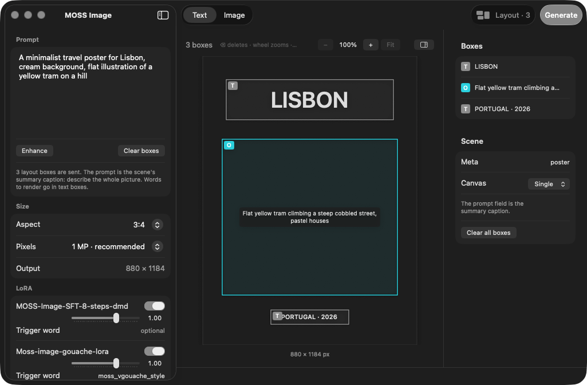

# MOSS Image for Mac

A native macOS app for generating images with [MOSS-Image](https://github.com/OpenMOSS/MOSS-Image),
OpenMOSS's 5B text-to-image model with strong text rendering, running locally on Apple Silicon through
[moss-image-mlx](https://github.com/felix-ab/moss-image-mlx).


No ComfyUI, no CUDA. A 1024×1024 image takes about 40 seconds on an M4 Pro with the 8-step adapter,
and the compact model needs about 7 GB of memory.

## What it does

**Text to image.** Prompt, aspect ratio and pixel budget, then Generate. Right-click a result for four more
seeds or a 2 MP re-render of the same seed; press ⌘↩ while a render runs to queue another. Queued renders
share one model load.

**Layout editor.** MOSS-Image's distinctive feature: control where text and objects go. Press **Layout** in
the toolbar and draw boxes over the picture; move them, resize them by the corners, delete with ⌫. A box is
Text (the exact words to render, with a caption for font and colour), Object or Character. The prompt is
the scene's summary caption; the app compiles the boxes to the model's JSON layout format. **Enhance** can
draft the boxes from a short idea.



The same three boxes, generated (8-step adapter, 880×1184, 29 s on an M5 Pro):


**Image to image.** Switch to **Image** and drop a picture in. Draw a text box over the words you want
replaced, type the new ones, Generate: only the box areas are regenerated (feathered edge), everything
outside stays pixel-identical, and the result becomes the working image with your boxes still in place.
A **Fill** box regenerates an area without placing anything (remove something, or describe what should
appear). With no boxes, the whole image is re-rendered at the strength slider. The strip under the canvas
holds the original and every render; click one to work on it.


**Prompt enhancer.** Expands a short idea into a detailed caption, or into a layout with boxes when the
editor is open. Runs locally through mlx-lm (Qwen3 4B by default, about 4 s per prompt once downloaded),
or through the Claude API with your own key. Revert with one click.

**LoRA library.** Search the Hugging Face Hub inside the app, or add local files. Several adapters can be
active at once, each with its own strength and trigger word; trigger words are added to the prompt only
while the adapter is on. The [lodestones 8-step DMD adapter](https://huggingface.co/lodestones/MOSS-Image-SFT-8-steps-dmd)
is installed by default: 8 steps, no CFG, roughly 12× faster than the stock 50-step sampler.

**Also:** scroll-wheel zoom and right-drag pan on every canvas; advanced settings (steps, CFG, negative
prompt, seed, model tier, mask edge softness, skip-layer guidance); a JSON sidecar with the exact settings
next to every PNG; Move to Trash from the history.

## Requirements

- Apple Silicon Mac with 16 GB or more. 24 GB for the 8-bit model.
- macOS 14 or later.
- Swift toolchain: `xcode-select --install` is enough, Xcode is not required.
- Python 3.11 or later, or [uv](https://docs.astral.sh/uv/) (used automatically if present).
- About 15 GB of disk: 12 GB model, 1.2 GB adapter, build artifacts.

## Install

```bash
git clone https://github.com/StefanVonRanda/moss-image-mac.git
cd moss-image-mac
./setup.sh
open MossImage.app
```

`setup.sh` creates a Python environment in `~/moss-mlx`, installs moss-image-mlx with the LoRA patches
from `patches/`, downloads the 8-step adapter into `~/moss-mlx/loras`, and builds the app. Run it again
any time; finished steps are skipped. To install somewhere else: `MOSS_HOME=/path ./setup.sh`, then set
the paths in the app's Settings (⌘,).

The model itself (12 GB) downloads from Hugging Face the first time you generate.

## Use

1. Type a prompt, pick an aspect and a pixel budget, press ⌘↩. Images land in `~/Pictures/MOSS Image`.
2. Layout: press **Layout**, drag on the picture to draw a box, select Text in the inspector and type the
   exact words. The prompt describes the whole scene. Or write a short idea and press **Enhance** with the
   editor open to have the model draft the boxes.
3. Image to image: switch to **Image**, drop a file or right-click a result and choose "Use as source
   image". Draw a box over what should change, type the new text (or make it a Fill box), Generate. The
   prompt is not used for box edits. Keep **Pixels** at 1 MP or more so text boxes are large enough; the
   app refuses boxes under 40 px.
4. Style LoRAs: **Download…**, search the Hub, Get. Toggle it on, set its strength, paste its trigger word
   if it has one.
5. Enhance uses a local MLX chat model by default (Settings, ⌘,; first use downloads it). Switch the
   backend to Claude there if you prefer, with an Anthropic API key kept in your keychain.

Tips for MOSS-Image prompts, layout JSON and text rendering are in the
[MOSS-Image user guide](https://github.com/OpenMOSS/MOSS-Image/blob/main/USERGUIDE.md).

## The moss-image-mlx patches

moss-image-mlx 0.1.0 has no adapter loading and no image input. `patches/` adds:

- `--lora PATH[:SCALE]`, repeatable. Adapters are applied unmerged beside the quantized base weights, in
  fp32, which is what the few-step DMD adapters need (their deltas are smaller than bf16 rounding and vanish
  if merged). kohya and diffusers/PEFT key formats are both read. Upstream PR:
  [felix-ab/moss-image-mlx#2](https://github.com/felix-ab/moss-image-mlx/pull/2).
- `--init PATH --strength F --mask PATH`: an MLX port of the Flux2 VAE encoder (weights fetched from the
  official OpenMOSS repo on first use, 237 MB), flow-matching image-to-image, and per-step latent blending for
  inpainting. Encoder parity against the PyTorch VAE: max abs diff 0.024 on fp32 latents, 40.8 dB round trip.

`setup.sh` applies the patches to the pinned upstream commit.

## Build from source

```bash
./build.sh          # swift build + app bundle, writes MossImage.app
./tests.sh          # headless checks compiled against the app sources (see below)
```

`tests.sh` builds `Tests/checks/main.swift` together with the app's non-UI sources and runs 43 checks:
layout compilation against the documented example, enhancer draft parsing, the batch JSON the app
sends versus the fields the CLI accepts, trigger-word merging, size presets, source-aspect matching,
mask-from-boxes pixels, the empty-text-box guard, a real two-image batch through the queue, the local
enhancer, and Hub search. The live checks need the venv from `setup.sh` and the cached model.

The icon is rendered by `icon/make_icon.swift`:

```bash
swiftc -O icon/make_icon.swift -o icon/make_icon && ./icon/make_icon icon
iconutil -c icns icon/AppIcon.iconset -o icon/AppIcon.icns
```

For documentation screenshots, `MOSS_SCREENSHOT=/path/shot.png open MossImage.app` captures the
window two seconds after launch and quits.

## License

Apache-2.0. Not affiliated with OpenMOSS. MOSS-Image is their model and trademark; this app only
drives it.
