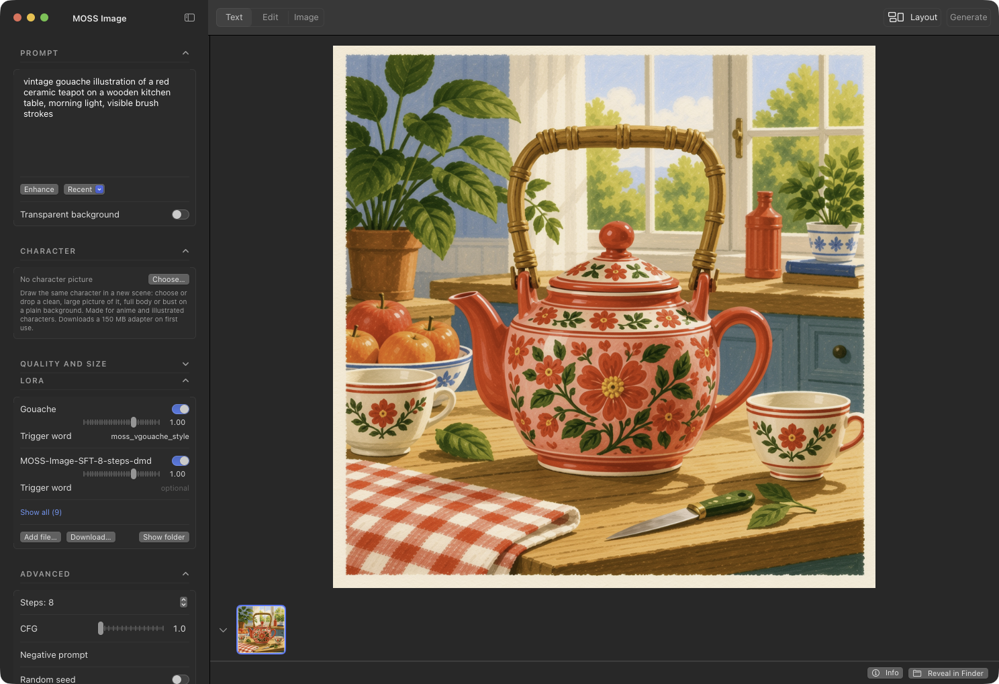
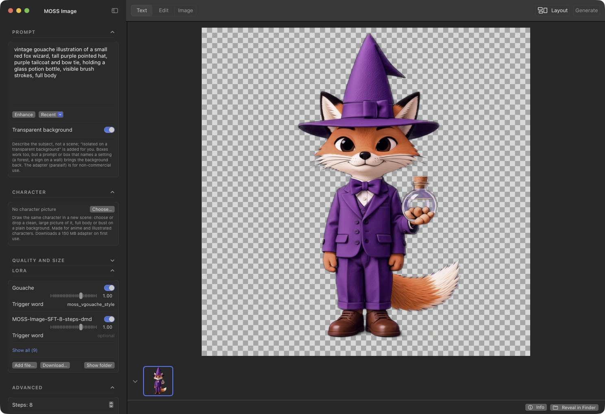
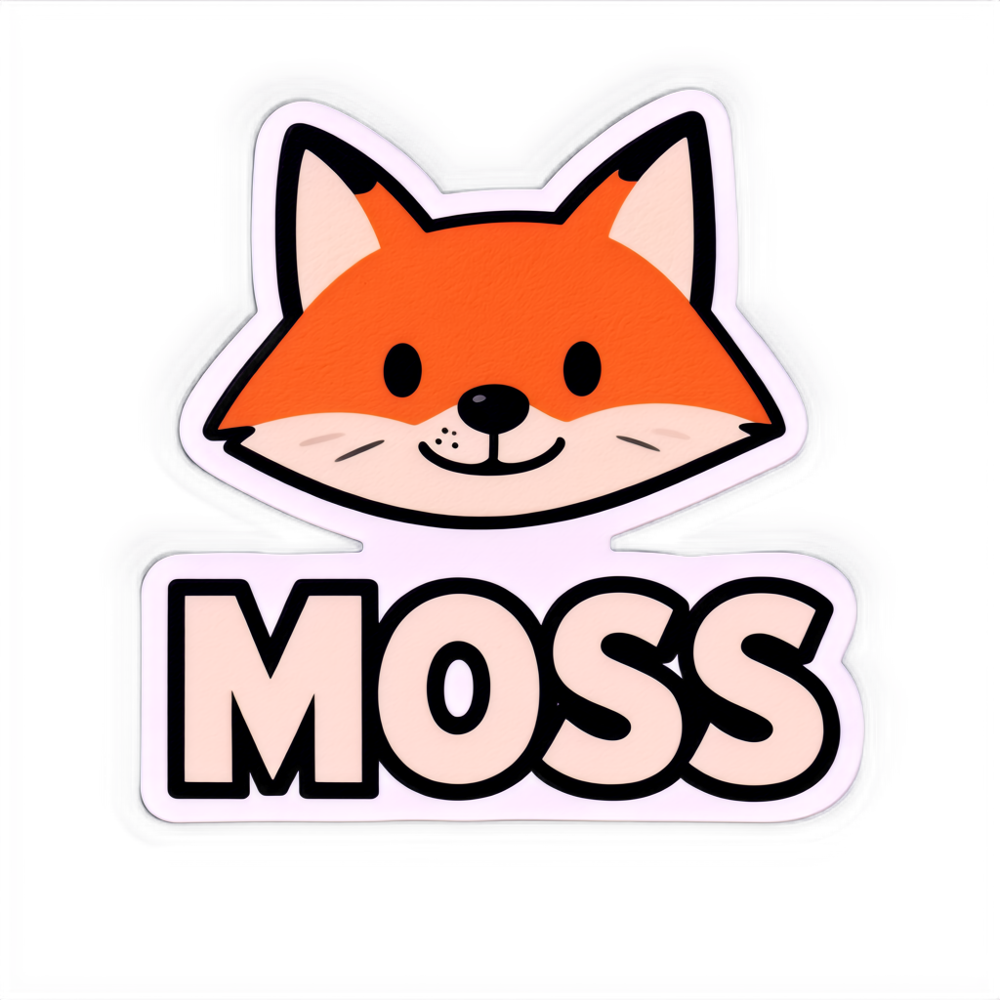
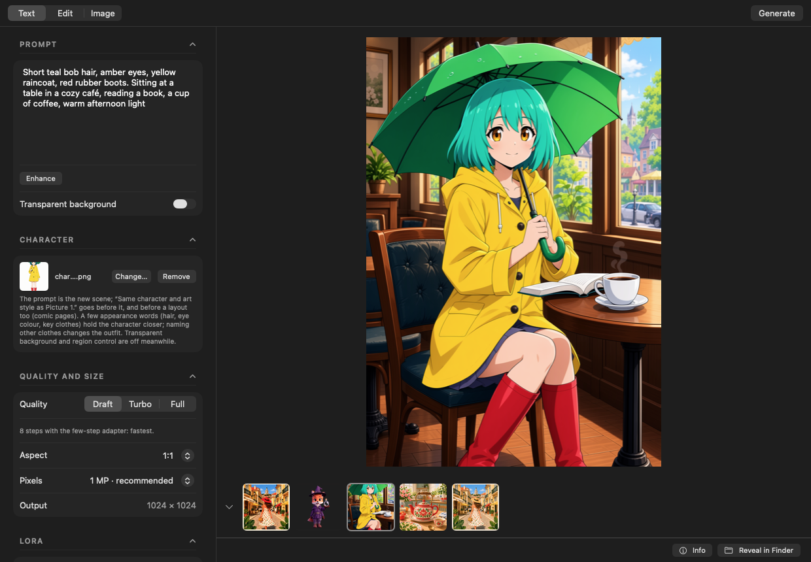
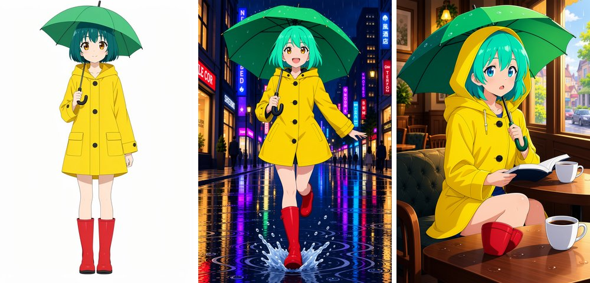
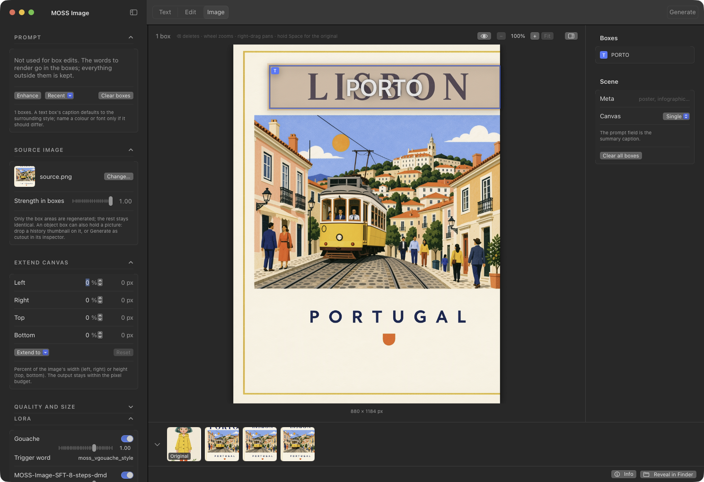
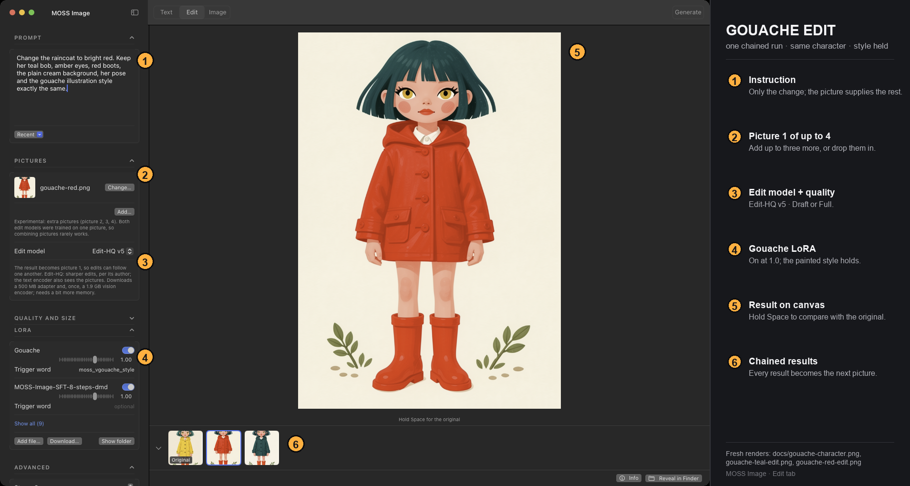
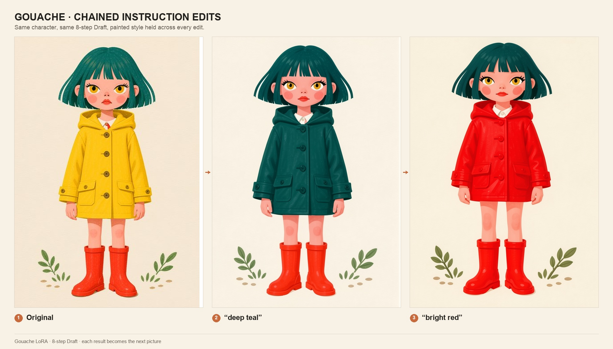

# MOSS Image for Mac

A native macOS app for generating images with [MOSS-Image](https://github.com/OpenMOSS/MOSS-Image),
OpenMOSS's 5B text-to-image model with strong text rendering, running locally on Apple Silicon through
[moss-image-mlx](https://github.com/felix-ab/moss-image-mlx).



No ComfyUI, no CUDA, no Python to wire up. A 1024×1024 image takes about 40 seconds on an M4 Pro with the 8-step
adapter, and the compact model needs about 7 GB of memory. Nothing leaves your Mac unless you send a
render to a ComfyUI server or use the Claude prompt enhancer.

## What only this app does

- **Native SwiftUI, one window.** The model runs locally by default: no ComfyUI, no Python front end,
  no browser tab.
- **A real layout editor.** Draw Text, Object, Fill and Character boxes on the picture, with the prompt as
  the scene caption; the app compiles them to MOSS-Image's layout JSON. Enhance can draft the boxes from
  a short idea.
- **An Edit tab.** Say what to change and keep the rest: MOSS Image Edit or Edit-HQ v5, chained edits, up
  to four pictures, and optional transparency preservation.
- **Transparency you can use.** A PNG with a genuine alpha channel, including layout boxes, via paralaif's
  alpha LoRA and the RGBA VAE.
- **A character reference.** Draw the same character again in a new scene with CharRef v2.
- **A LoRA library.** Search the Hugging Face Hub, import local files, stack adapters, set strengths and
  trigger words; the 8-step DMD adapter is installed by default.
- **Quality done for you.** Draft (8 steps), Turbo (the engine's trained 15-pass sampler) or Full
  (50 steps, CFG 3), with the right adapters and settings for each.
- **A remote backend when you need it.** Send renders to a ComfyUI server while history, the layout
  editor, image-to-image and the enhancer stay local.

## Install

The app is free and **not notarized by Apple**. The one-line installer is the smoothest path; the DMG
needs one extra Gatekeeper step the first time.

### 1. The one-line installer (recommended)

```bash
curl -fsSL https://raw.githubusercontent.com/StefanVonRanda/moss-image-mac/main/install.sh | zsh
```

It finds the latest release, verifies its SHA-256 checksum, and installs the app into
`/Applications` (or `~/Applications` when that is not writable — it never uses `sudo`). An older copy is
replaced only after the download checks out, and running it again is safe. Pin a version with:

```bash
curl -fsSL https://raw.githubusercontent.com/StefanVonRanda/moss-image-mac/main/install.sh | zsh -s -- 1.0.0
```

Because `curl` downloads carry no quarantine flag, macOS opens the app without complaint.

### 2. Download the DMG

Download `MossImage-1.0.0.dmg` from the [releases page](https://github.com/StefanVonRanda/moss-image-mac/releases),
open it and drag **MOSS Image** onto the Applications folder. The first launch is blocked by Gatekeeper:

- **macOS 15 or newer:** try to open it, click **Done**, then go to **System Settings → Privacy &
  Security**, scroll to *"MOSS Image was blocked"* and click **Open Anyway**.
- **macOS 14:** Control-click (or right-click) **MOSS Image** in Applications, choose **Open**, then
  **Open** again.

You only do this once. The DMG contains the same instructions.

### 3. Build from source

For development, or if you prefer to run the engine from your own Python environment:

```bash
git clone https://github.com/StefanVonRanda/moss-image-mac.git
cd moss-image-mac
./setup.sh
open MossImage.app
```

This needs **full Xcode** (not just the Command Line Tools) and Python 3.11+ or [uv](https://docs.astral.sh/uv/).
See [Build from source](#build-from-source) for what `setup.sh` does and how to run the checks.

## Requirements

- Apple Silicon Mac (M1 or newer). Intel Macs are not supported.
- macOS 14 (Sonoma) or newer.
- **16 GB of memory** for the Compact model (the default); **24 GB** to use the 8-bit model.
- **16 GB of free disk** before the first run: about 1.5 GB of engine plus the 12 GB model (14 GB for
  8-bit), with room to grow for your images.
- An internet connection for the first run, to download the engine and the model.
- **To build from source:** full Xcode, because the app uses SwiftUI's macros and the Command Line Tools
  do not ship their plugin. `xcode-select --install` alone is not enough.

## First run

1. The first launch opens a setup window. It checks that the Mac is Apple Silicon, on macOS 14+, has
   enough memory and at least 16 GB free.
2. It downloads about **1.5 GB** (a Python runtime, the packages and the 8-step DMD adapter) and installs
   the engine. Progress is shown in plain words; you can Cancel and Retry, and **Copy Log** keeps the
   details if something fails. A half-finished install is never used.
3. The first **Generate** downloads the image model — **12 GB** for Compact, **14 GB** for 8-bit — into
   the Hugging Face cache. Later renders start from the cache.

Where things live:

| What | Where |
| --- | --- |
| The app | `/Applications/MossImage.app` (or `~/Applications`; Finder shows it as MOSS Image) |
| Engine, LoRAs, adapters | `~/Library/Application Support/MOSS Image/` |
| Downloaded models | `~/.cache/huggingface/hub/` |
| Your images and their JSON sidecars | `~/Pictures/MOSS Image/` |
| Settings | ⌘, (Engine location, version and **Reinstall Engine…** are on the first tab) |

If you installed with `setup.sh`, the app uses that environment (`~/moss-mlx` by default) and leaves it
alone; nothing is migrated. To move the engine, change the executable path in Settings.

## Use

1. Type a prompt, pick an aspect and a pixel budget, press ⌘↩. Images land in `~/Pictures/MOSS Image`;
   right-click one for more seeds, a 2 MP re-render or to reuse it as a source or reference.
2. Layout: press **Layout**, drag on the picture to draw a box, select Text in the inspector and type the
   exact words. The prompt describes the whole scene. Or write a short idea and press **Enhance** with
   the editor open to have the model draft the boxes.
3. Image to image: switch to **Image**, drop a file or right-click a result and choose "Use as source
   image". Draw a box over what should change, type the new text (or make it a Fill box), Generate. The
   prompt is not used for box edits. Keep **Pixels** at 1 MP or more so text boxes are large enough; the
   app refuses boxes under 40 px.
4. Style LoRAs: **Download…**, search the Hub, Get. Toggle it on, set its strength, paste its trigger word
   if it has one.
5. Enhance uses a local MLX chat model by default (Settings, ⌘,; first use downloads about 2.5 GB).
   Switch the backend to Claude there if you prefer, with an Anthropic API key kept in your keychain.

Tips for MOSS-Image prompts, layout JSON and text rendering are in the
[MOSS-Image user guide](https://github.com/OpenMOSS/MOSS-Image/blob/main/USERGUIDE.md).

## Features

### Text to image

Prompt, aspect ratio and pixel budget, then Generate. Right-click a result for four more seeds or a
2 MP re-render of the same seed; press ⌘↩ while a render runs to queue another. Queued renders share
one model load.

**Transparent background** gives a PNG with a real alpha channel: the subject only, glass and thin edges
partly see-through. It adds paralaif's alpha LoRA and decodes with an RGBA VAE (both downloaded on first
use); describe the subject, not a scene. The result view shows transparency as a checkerboard.




It works with layout boxes too, e.g. a sticker: an object box "a cartoon fox head" over a text box "MOSS" came out
transparent around both, with the right letters in the right places (3 of 3 seeds, 0% opaque pixels outside the boxes).
The model sets the limit: a prompt or box caption that names a setting ("in a sunny forest clearing", "a wooden sign")
renders that scene whatever the trigger says, with or without boxes, so keep captions to the subject.



**Character** draws the character in a picture again, in a new scene: choose or drop a picture in the Character section
(a clean, large one, full body or bust on a plain background), then write the scene as the prompt. It adds 7err4's
CharRef v2 adapter (150 MB, downloaded on first use) and sends the picture as Picture 1 in the format it was trained
on; the app puts its caption prefix "Same character and art style as Picture 1." before your prompt, or before the
layout for comic pages. A few appearance words (hair, eye colour, key clothes) hold the character closer; naming other
clothes changes the outfit. Made for anime and illustrated characters. CharRef was trained on the Base model but holds
the character on the SFT tiers here: on Compact, Draft (8 steps, 832×1216) kept hair, eyes and raincoat, and with the
gouache LoRA on, the painted style too; Full (50 steps, CFG 3, 6.5 min) kept it as well, no closer. Turbo takes
no reference picture and renders as Draft; transparency and region control are off while a character picture is set.





### Layout editor

MOSS-Image's distinctive feature: control where text and objects go. Press **Layout** in the toolbar
and draw boxes on the page; move them, resize them by the corners, delete with ⌫. A box is Text (the
exact words to render, with a caption for font and colour), Object, Fill (image to image) or Character.
The prompt is the scene's summary caption; the app compiles the boxes to the model's JSON layout format.
**Enhance** can draft the boxes from a short idea.


The same three boxes, generated (8-step adapter, 880×1184):


### Image to image

Switch to **Image** and drop a picture in. Draw a text box over the words you want replaced, type the
new ones, Generate: only the box areas are regenerated (feathered edge), everything outside stays
pixel-identical, and the result becomes the working image with your boxes still in place. A **Fill**
box regenerates an area without placing anything (remove something, or describe what should appear).
With no boxes, the whole image is re-rendered at the strength slider. The strip under the canvas holds
the original and every render; click one to work on it.



The result, boxes hidden with the eye button. Only the title changed; the rest of the picture is the
original pixel for pixel:


### Edit

The **Edit** tab edits a picture by instruction, with [MOSS Image Edit](https://huggingface.co/chinoll/Moss-Image-Edit)
or [Edit-HQ v5](https://huggingface.co/akhaliq/MOSS-Image-Edit-HQ) (the default): drop a picture in, say what to change
("Change her raincoat to deep teal"), Generate. The picture, pose and style are kept; the picture goes to the
model as a clean reference, not as a starting point, so nothing has to be masked. The result becomes the picture, so
edits chain; hold Space to compare with the original. Up to three more pictures can be added for the prompt to refer to
as picture 2, 3, 4 (drop them on Pictures, or "Use as reference" on a result). That part is experimental: both edit
models were trained on single-picture edits, so combining pictures mostly pastes picture 2 over picture 1; "Edit this picture" on a result opens it
here. Edits run as Draft (8-step adapter, about 50 s at 1 MP on an M5 Pro) or Full; the edit adapter downloads on the
first edit. The Edit tab keeps its own picture and prompt apart from the Text and Image tabs. The examples below are
one chained run with the Gouache LoRA on: yellow raincoat, then deep teal, then bright red.





### Remote renders (ComfyUI)

From Settings (⌘,) the **Generate on** selector can send renders to a ComfyUI server instead: a Mac with no
moss-mlx install, or a server elsewhere in the house, can carry the load while everything else — history, layout
editor, image-to-image, prompt enhancer — stays local. Pick **ComfyUI server**, enter its address and the
three model filenames, and press Test connection.

- **On the server:** ComfyUI 0.42 or newer with MOSS-Image support (the official template's build). The app
  drives the same native nodes the template's subgraph wraps: `UNETLoader` + `CLIPLoader` (type `moss_image`)
  + `VAELoader` + `KSampler` (er_sde/simple) + `SkipLayerGuidanceDiTSimple`, extended with
  `LoadImage`/`VAEEncode`/`SetLatentNoiseMask` for image-to-image and `LoraLoaderModelOnly` for adapters.
  The default filenames are the template's: `moss_image_sft_int8_convrot.safetensors`,
  `qwen3.5_9b_w4a8_gptq.safetensors`, `flux2-vae_small.safetensors`.
- **LoRAs are translated, not shared:** the sidebar's active adapters drive remote renders at their own
  strengths; the field in Settings maps a local file to a differently named server file
  (`localname=servername:0.8`), and plain entries are always-on remote extras. Server-side files stay
  server-side; nothing is uploaded per render except the source and mask PNGs of the edit being made.
- **What differs remotely:** the model tier selector applies only to the local backend (the checkpoint field
  decides remotely); negative-branch skip layers have no ComfyUI equivalent and are ignored; the blurred
  per-step preview becomes step counting and an ETA (graph previews ride the WebSocket protocol, a later
  addition). Failures surface as status messages, never silent fallbacks — a dead server reports itself, an
  errored prompt fails fast with the server's own error text.
- **Security note:** ComfyUI has no built-in authentication. Keep the server on your LAN/VPN; an optional
  bearer token in Settings goes out as `Authorization: Bearer` on every request for front-end proxies that
  check one.

### Prompt enhancer

Expands a short idea into a detailed caption, or into a layout with boxes when the editor is open.
Runs locally through mlx-lm (Qwen3 4B by default, about 4 s per prompt once downloaded), or through
the Claude API with your own key. Revert with one click.

### LoRA library

Search the Hugging Face Hub inside the app, or add local files. Several adapters can be active at
once, each with its own strength and trigger word; trigger words are added to the prompt only while
the adapter is on. The [lodestones 8-step DMD adapter](https://huggingface.co/lodestones/MOSS-Image-SFT-8-steps-dmd)
is installed by default: 8 steps, no CFG, roughly 12× faster than the stock 50-step sampler.

### Quality

Draft, Turbo or Full, next to the size. **Draft** renders with the few-step DMD adapter (8 steps, no CFG;
picking Draft turns it on if no few-step adapter is). **Turbo** is the engine's `--turbo`: a trained
15-pass sampler close to the full model, about twice Draft's time; the first run downloads 600 MB. It
makes new pictures only, so edits, extensions, character references and control renders run as Draft.
**Full** is the official 50 steps with CFG 3, with the destripe adapter that removes the SFT checkpoint's
faint vertical stripes (as upstream's reference renders do). Turbo and Full leave the few-step adapters
out of that render; they stay on in the library, and your other adapters apply as usual. Picking a
quality sets Steps and CFG in Advanced, still editable there (Turbo ignores Steps). Variations and
re-renders of an image keep the quality it was made with.

### Also

Scroll-wheel zoom and right-drag pan on every canvas. Advanced settings: steps, CFG, negative prompt,
seed, model tier, mask edge softness, skip-layer guidance. A JSON sidecar with the exact settings next
to every PNG. Move to Trash from the history. The toolbar's sidebar button hides the controls when you
want the picture to yourself.

## Troubleshooting

### "MOSS Image is damaged and can't be opened"

The app is ad-hoc signed, not notarized: `codesign --verify --deep --strict` passes, but `spctl --assess`
rejects it (no Developer ID), which is exactly the warning Gatekeeper shows. Use the steps under
[Download the DMG](#2-download-the-dmg), or install with the one-line command, which avoids the
quarantine flag entirely.

### Setup can't download the engine

Check the connection (and any proxy or VPN), then press **Retry**. Setup needs to reach GitHub and
PyPI. If it keeps failing, open **Copy Log** and include it in a bug report. No partially installed
engine is left behind.

### A render fails, or the Mac runs out of memory

Pick the **Compact** tier and **Draft** quality, close memory-hungry apps, and try a smaller pixel
budget. The 8-bit model wants 24 GB of memory; on a 16 GB Mac use Compact. The **Log** button shows the
engine's own error.

### "Not enough free space"

Setup wants 16 GB free before the first run (the engine plus the 12 GB Compact model). Free some space
and press **Retry**. Downloaded models live in `~/.cache/huggingface/hub/`; removing that folder frees
the model but the next render downloads it again.

### Where is the log?

Above the status bar: **Log** (it appears once a render starts, with a warning icon on failure). Open it,
press **Copy**, and paste it into an issue. The setup window has its own **Copy Log**.

### ComfyUI says it cannot connect

Check the address (`http://host:8188`), that the server is on the same LAN or VPN, and the token if your
proxy needs one. The server needs ComfyUI 0.42+ with MOSS-Image support, and the three model filenames
must match the server's `models/` folder. **Test connection** in Settings reports the server's answer.

### The sidebar disappeared

The titlebar button next to the app name shows and hides it; the window needs at least 760 pt of width
for both columns.

## Uninstall

Quit the app, then remove what you no longer want:

```bash
rm -rf "/Applications/MossImage.app"                  # or ~/Applications/MossImage.app
rm -rf "$HOME/Library/Application Support/MOSS Image" # engine, LoRAs, adapters
rm -rf "$HOME/Pictures/MOSS Image"                    # your images and sidecars
rm -rf "$HOME/.cache/huggingface/hub"                 # the downloaded model (shared HF cache)
defaults delete dk.vonranda.mossimage 2>/dev/null     # settings
rm -rf "$HOME/moss-mlx"                               # only for a setup.sh install
```

The Hugging Face cache is shared with other tools; delete only the model folders you recognize if you
use it elsewhere. If you saved an Anthropic key or a ComfyUI token, remove `anthropic-api-key` and
`comfy-token` from Keychain Access.

## The moss-image-mlx patches

moss-image-mlx 0.2.0 has no adapter loading, no image input and no editing. `patches/` adds:

- `--lora PATH[:SCALE]`, repeatable. Adapters are applied unmerged beside the quantized base weights, in
  fp32, which is what the few-step DMD adapters need (their deltas are smaller than bf16 rounding and vanish
  if merged). kohya and diffusers/PEFT key formats are both read. Upstream PR:
  [felix-ab/moss-image-mlx#2](https://github.com/felix-ab/moss-image-mlx/pull/2).
- `--init PATH --strength F --mask PATH`: an MLX port of the Flux2 VAE encoder (weights fetched from the
  official OpenMOSS repo on first use, 237 MB), flow-matching image-to-image, and per-step latent blending for
  inpainting. Encoder parity against the PyTorch VAE: max abs diff 0.024 on fp32 latents, 40.8 dB round trip.
- `--preview PATH`: each step rewrites PATH with the model's current estimate of the image at 1/16 size,
  projected from the latents by a fitted linear map (no VAE decode, ~1.5 ms per step). The app shows it
  blurred while a render runs; with an older CLI it simply shows no preview.
- `--reference IMAGE`, repeatable: instruction editing with
  [MOSS Image Edit](https://github.com/Chenkin-x/Moss-Image-Edit). The references run through the DiT once at
  timestep 0, attending only to each other, and their per-block keys and values are kept for every step and
  both CFG branches. Checked against the edit written out as one masked sequence.
- `--rgba`: decode with the RGBA FLUX.2 VAE for a transparent PNG; LoRAs that adapt a fused `qkv` (ai-toolkit)
  are split onto MOSS's separate q, k and v.
- `--control ADAPTER --control-color PNG --control-depth PNG --control-end F`:
  [colour/depth control](https://huggingface.co/darask0/MOSS-Image-color-depth-control). The adapter's wider
  `video_embedder` reads the noisy latent next to the VAE latents of a flat-colour region map and a depth map
  (near = white; either may be left out), its LoRA covers the blocks and the text embedder. The maps act on the
  first F of the steps (default 0.5 as the card recommends; with the 8-step DMD adapter 0.25 avoids the
  mannequin look of synthetic maps, 1.0 for maps from real photos). Combines with `--init` and `--reference`
  (references see zero control); refused with `--turbo`. Request fields `control_color`, `control_depth`,
  `control_end`.

`setup.sh` applies the patches to the pinned upstream commit. Re-running it on an existing install applies
only the patches that are not in its history yet (matched by subject), so new patches arrive without a reinstall.
To upgrade, `git pull` this repo and run `./setup.sh` again. An install on an older pinned upstream is moved to
the new pin on a fresh branch (the old state stays on a `pre-upgrade-*` branch); if `~/moss-mlx/src` has
uncommitted changes, setup stops and changes nothing until you commit or stash them.

## Build from source

`setup.sh` creates the venv in `~/moss-mlx`, installs moss-image-mlx with the patches, downloads the
8-step adapter and builds the app. Run it again any time; finished steps are skipped. To install
somewhere else: `MOSS_HOME=/path ./setup.sh`, then set the paths in Settings (⌘,).

Day to day:

```bash
./build.sh          # swift build + app bundle, writes MossImage.app
./tests.sh          # headless checks compiled against the app sources
scripts/check.sh    # the full release gate: build, tests, script syntax, patches, engine lock
```

`tests.sh` compiles `Tests/checks/main.swift` together with the app's non-UI sources and runs the
headless checks: layout compilation against the documented example, enhancer draft parsing, the batch
JSON the app sends versus the fields the CLI accepts, trigger-word merging, size presets,
source-aspect matching, mask-from-boxes pixels, the empty-text-box guard, a real two-image batch
through the queue, the local enhancer, Hub search, the remote ComfyUI path and the image cache. The
live checks need the venv from `setup.sh` and the cached model.

Building needs full Xcode: SwiftUI's macros are part of the Xcode toolchain, not the Command Line
Tools. `scripts/toolchain.sh` picks Xcode when `xcode-select` points at the Command Line Tools, and
says what to install when Xcode is missing. There is no cloud CI; `scripts/check.sh` is the gate, and
`scripts/release.sh` runs it before building the zip, DMG and checksums.

The icon is `icon/art.svg`; `icon/make_icon.swift` draws it at every size, masked to the macOS icon grid:

```bash
swiftc -O icon/make_icon.swift -o icon/make_icon && ./icon/make_icon icon
iconutil -c icns icon/AppIcon.iconset -o icon/AppIcon.icns
```

For documentation screenshots, `MOSS_SCREENSHOT=/path/shot.png open MossImage.app` captures the
window two seconds after launch and quits.

## Credits

- [MOSS-Image](https://github.com/OpenMOSS/MOSS-Image) by OpenMOSS, Apache-2.0. The model and the
  layout format. Not affiliated; MOSS-Image is their name and trademark, this app only drives it.
- [moss-image-mlx](https://github.com/felix-ab/moss-image-mlx) by felix-ab, Apache-2.0. The Apple Silicon
  port this app runs on.
- The ComfyUI backend comes from [mufflegyro's fork](https://github.com/mufflegyro/moss-image-mac),
  merged into the app.
- [MOSS-Image-SFT 8-step DMD](https://huggingface.co/lodestones/MOSS-Image-SFT-8-steps-dmd) by lodestones,
  Apache-2.0. The few-step adapter installed by default.
- [Moss Image Gouache LoRA](https://huggingface.co/axiomofmind/Moss-image-gouache-lora) by axiomofmind,
  Apache-2.0, trigger `moss_vgouache_style`. The painterly style in the chained edit examples.
- [MOSS Image Edit](https://huggingface.co/chinoll/Moss-Image-Edit) by chinoll, the instruction-edit LoRA,
  downloaded on the first edit (no licence stated on the model card; the training code is GPL-3.0).
- [MOSS-Image-Edit-HQ v5](https://huggingface.co/akhaliq/MOSS-Image-Edit-HQ) by akhaliq, the default
  edit adapter, Apache-2.0.
- [MOSS-Image CharRef](https://huggingface.co/7err4/MOSS-Image-CharRef) by 7err4, Apache-2.0. The character
  reference adapter, downloaded on first use.
- [MOSS-Image color/depth control](https://huggingface.co/darask0/MOSS-Image-color-depth-control) by
  darask0, Apache-2.0, and the destripe adapter by nynxz. Downloaded on first use.
- [MOSS-Image Alpha LoRA](https://huggingface.co/paralaif/MOSS-Image-Alpha-LoRA) by paralaif, **non-commercial
  research and evaluation use only**, and the RGBA VAE from
  [trmz/flux2-klein-alpha](https://huggingface.co/trmz/flux2-klein-alpha), Apache-2.0. Downloaded on the first
  transparent render.
- [Qwen3-4B-Instruct](https://huggingface.co/mlx-community/Qwen3-4B-Instruct-2507-4bit) via
  [mlx-lm](https://github.com/ml-explore/mlx-lm), the default local prompt enhancer.

## License

Apache-2.0.
